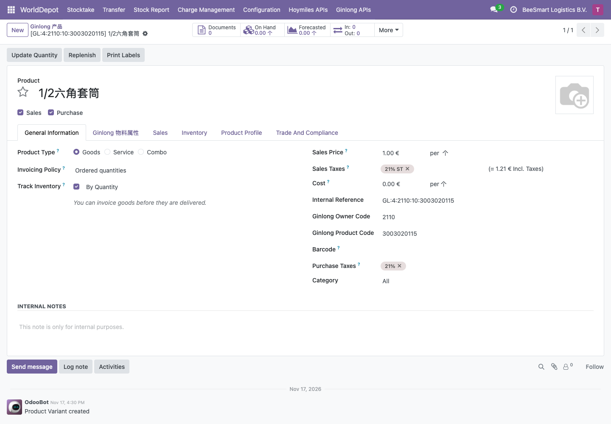
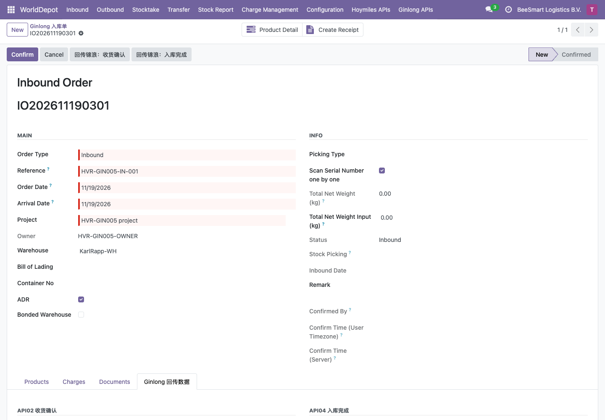
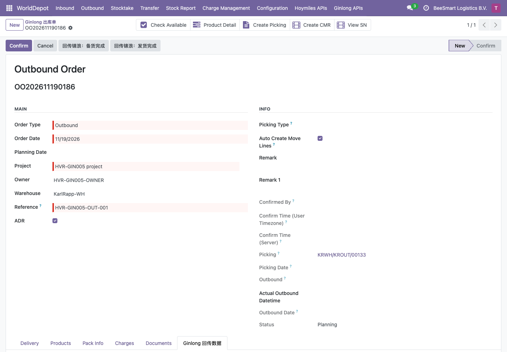
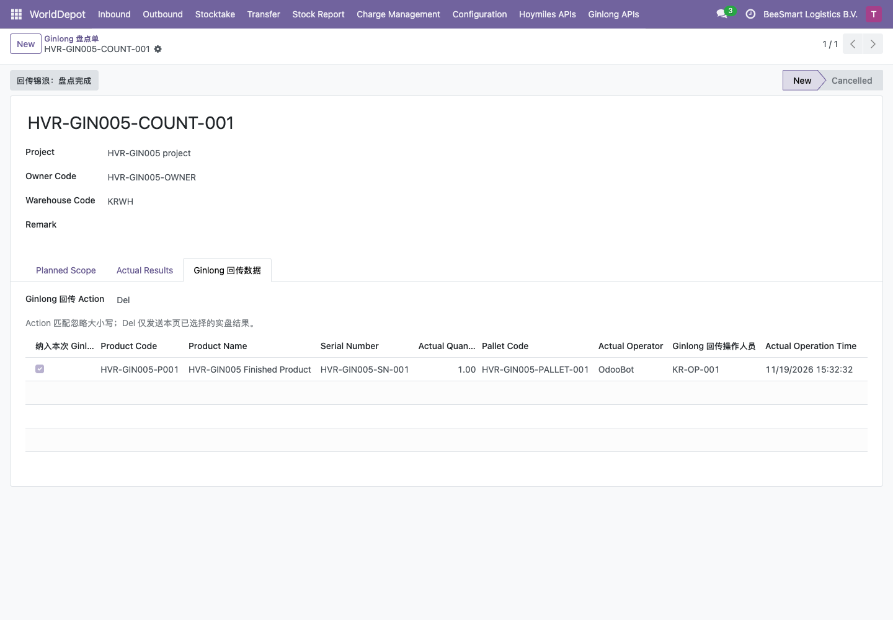

# 浏览器验收记录：HVR-GIN-005

## 验收环境

- Odoo 18 本地开发服务器：`127.0.0.1:8099`，既有数据库 `odooce_karlrapp`。
- Ginlong 回传目标：仅本机 Mock `127.0.0.1:18220`；无真实 Ginlong、生产或 Karl Rapp 请求。
- 测试用户、业务单据和产品为 `HVR-GIN005-*` ORM fixture；执行后删除临时 ACL、移除测试组、停用临时账号，并确认五个 Mock Endpoint 配置不存在。临时账号记录保留以维持 API 日志操作者关联。模拟业务单据及其不可改写历史 Picking/API 日志保留为可识别的测试记录。
- 所有操作经 Odoo UI 和 ORM；没有直接 PostgreSQL/SQL。

## 五个人工回传 Form

| API | 浏览器操作 | Mock / ORM 结果 |
|---|---|---|
| API02 收货确认 | 修改已保存收货状态为 Y，保存并重新打开；按钮第一次返回 HTTP 500；将状态改为 N，保存并重新打开后手动重试 | 两个独立日志；第一次记录 500 / `receiptConfirmed=Y`，第二次 200 / `receiptConfirmed=N`。历史日志不修改，无后台自动重试 |
| API04 入库完成 | 在关联标准已完成入库 Picking 的 Ginlong 回传 Form 中修改操作人 `KR-OP-001` → `KR-OP-BROWSER`，Tab 提交行编辑，保存并重新打开；再从 Order 按钮发送 | Odoo ORM 重开读取 `KR-OP-BROWSER`；Mock Payload 从保存的 Picking move line 读取 SN、数量、托盘、产品和操作时间 |
| API06 备货完成 | 将已保存人工毛重覆盖从 2.5 kg 改为 3.25 kg，保存、重新打开，再由出库 Order 按钮发送 | Payload `totalWeight="3.25"`；托盘数 1，SN/数量/托盘/操作人/时间来自关联备货实际行 |
| API08 发货完成 | 将持久化发货明细状态 Y 改为 N，保存并重新打开后点击出库 Order 回传按钮 | Payload `shipmentConfirmed=N`；API08 单独 POST，日志独立追加 |
| API10 盘点完成 | 将持久化 Action 从 Add 改为 Del，保存并重新打开后发送所选实盘记录 | Payload `action=Del`，实盘 SN、产品、数量、托盘、操作人和时间来自 `worlddepot` 实盘结果；没有查询或调整库存 |

五个请求均为 HTTP POST、`application/json`，用户页面不展示 JSON 编辑器。Mock 对所有可成功请求返回 `returnStatus=Y`；API02 首次故意返回 500。浏览器最终 JavaScript 错误数为 0。

最终一轮来源日志为：入库单 623/624（API02 失败/重试）及 625（API04）；出库单 626（API06）、627（API08）；盘点单 628（API10）。验证后所有回传日志均有关联来源单据。

## 产品 Form

浏览器打开 Ginlong 产品变体 Form，确认内部 Reference 与 Ginlong owner code、原始 Ginlong productCode 并列；模板 Form 的 Ginlong Notebook 显示共享规格、productForm、tracking、重量和尺寸。

## 回传表单截图

## 权限限制

首次使用普通库存用户访问入库 Order 时，现有 `world.depot.inbound.order` 模型 ACL 拒绝访问。仅在临时测试账号上使用临时 ACL 完成页面及按钮组件验收；收尾时删除 ACL 和临时组，并停用临时账号。该结果证明表单/发送链路可用，不证明实际业务操作用户组具有权限；CC-TEST-055 保持 PARTIAL，需确认现有 WMS 操作角色后再核实。

## 状态

本记录证明本地浏览器和 Mock 的组件流程，不代表真实 Ginlong 接口、真实 WMS 用户权限、Karl Rapp Gateway 或完整人工业务 E2E 已通过。CC-GIN-005 仍为 In Progress，待处理权限 Open Item 及 Human Review。
