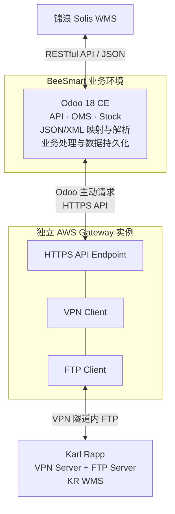
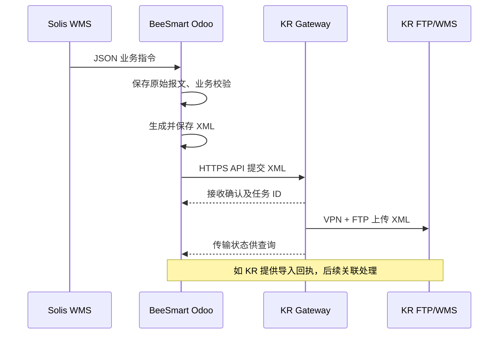
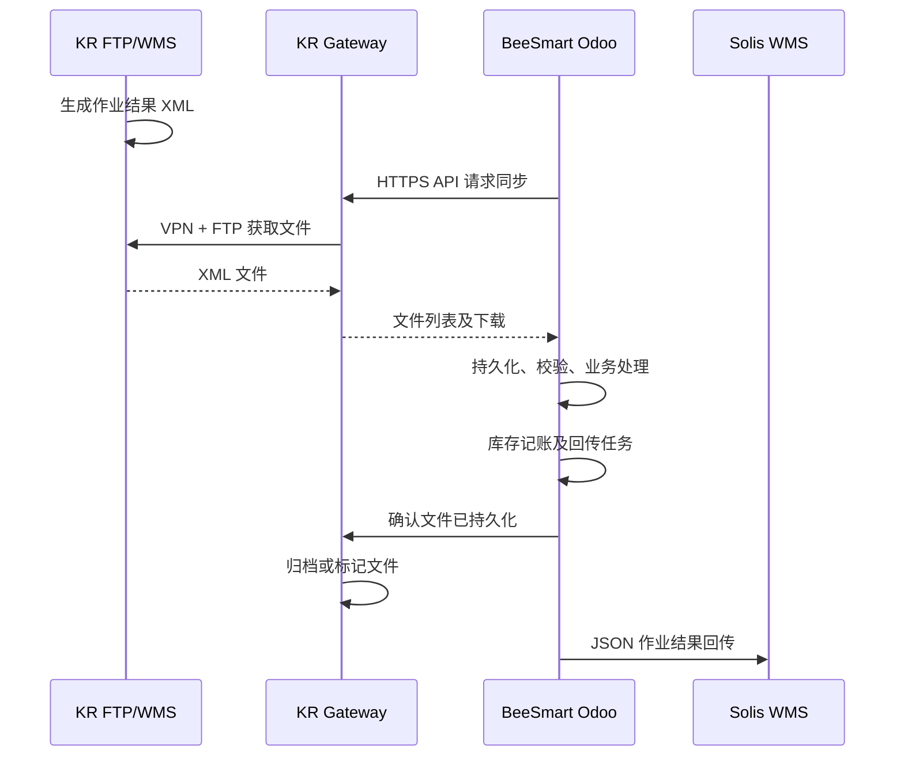

# BeeSmart 锦浪（Solis）与 Karl Rapp 数据对接技术方案说明

**文档编制**：BeeSmart IT 部门（李建强）
**日期**：2026 年 11 月 16 日
**版本**：v1.1
**状态**：技术方案评审稿
**适用对象**：BeeSmart 业务决策层、项目经理、Karl Rapp 技术团队
**说明**：第六节工作量为 BeeSmart 内部初步估算。

---

## 一、背景与目标

为满足锦浪（Ginlong）对物流数据可视化和自动化的需求，BeeSmart 采用方案 C：

- **锦浪 Solis WMS ↔ BeeSmart Odoo**：通过 RESTful API 交换 JSON 数据。
- **BeeSmart Odoo ↔ KR 独立前置机**：通过受控 HTTPS API 交换业务文件和任务状态。
- **KR 独立前置机 ↔ Karl Rapp WMS**：通过 VPN 隧道和 FTP 服务交换 XML 文件。

Karl Rapp（以下简称 KR）WMS 负责实际仓库作业，并提供作业结果及库存数据。

BeeSmart Odoo 负责业务指令处理、JSON/XML 映射、数据持久化、作业状态管理、KR 仓库存记账及锦浪 API 回传。

为降低跨系统连接风险，在独立 AWS 实例部署 **KR 数据交换前置机（Integration Gateway）**，同时承担 VPN Client、FTP Client 和 HTTPS API Endpoint 三项技术职责。

### 1.1 设计目标

1. Odoo 不加入 KR VPN 网络，不直接访问 KR FTP 服务。
2. KR 不直接访问 BeeSmart Odoo 服务器及数据库。
3. Odoo 主动调用 Gateway HTTPS API，实现双向业务数据交换。
4. Gateway 仅承担安全连接、文件传输、临时缓存及技术状态反馈，不承担业务处理。
5. 所有业务映射、状态流转、库存记账和业务防重均由 Odoo 统一完成。
6. 文件交换具备完整追踪、失败重试、重复识别及异常恢复能力。

## 二、总体架构设计

### 2.1 系统架构

**核心安全边界：**

- 锦浪与 Odoo 之间为业务 API 连接。
- Odoo 与 Gateway 之间为受控 HTTPS API 连接。
- Gateway 与 KR 之间为 VPN 隧道内的 FTP 文件交换。
- Odoo 与 KR 之间不存在直接网络连接。
- Gateway 不作为 KR VPN 网络与 BeeSmart 业务网络之间的通用路由器。

### 2.2 系统职责

| 系统            | 技术职责                                                                   |
| ------------- | ---------------------------------------------------------------------- |
| 锦浪 Solis WMS  | 通过 RESTful API 发送业务指令，接收作业结果及库存数据                                      |
| BeeSmart Odoo | 负责业务指令、JSON/XML 映射、任务调度、状态管理、库存记账、文件持久化及锦浪 API 回传                      |
| KR Gateway    | 提供 HTTPS API Endpoint，运行 VPN Client 和 FTP Client，负责文件传输、临时缓存、传输状态及技术日志 |
| Karl Rapp     | 提供 VPN Server、FTP Server，负责 XML 文件导入、仓库作业执行及结果文件导出                     |

### 2.3 Gateway 职责边界

Gateway 是独立的数据交换组件，不是第二套业务系统。

**Gateway 负责：**

- 接收 Odoo API 请求及待发送 XML 文件。
- 通过 VPN 连接 KR FTP Server。
- 上传业务指令文件。
- 下载 KR 作业结果及库存文件。
- 提供文件列表、文件下载、任务状态查询及接收确认接口。
- 对传输文件进行完整性检查、安全限制及临时缓存。
- 记录传输日志、错误信息和重试状态。

**Gateway 不负责：**

- JSON/XML 业务字段映射。
- 业务单据合法性判断。
- 仓库作业状态流转。
- 库存增加、扣减或调整。
- SN、托盘、产品及订单的业务关联。
- 锦浪 API 业务回传。

Gateway 可执行通用 XML 安全解析或格式检查，但不解释具体业务字段。XML 业务校验集中在 Odoo 完成。

### 2.4 网络与部署原则

Gateway 部署在独立 AWS 实例，与 Odoo 业务服务器隔离。

网络访问遵循最小权限原则：

1. Gateway 仅允许与 KR 指定 VPN Endpoint 建立连接。
2. VPN 建立后，仅允许访问 KR 指定 FTP Server 的必要端口。
3. Gateway HTTPS API 仅允许 Odoo 通过授权网络路径访问。
4. Odoo 与 Gateway 优先采用 AWS 私有网络连接，避免 API 直接暴露于公网。
5. Gateway 禁止开启通用 IP Forwarding 或跨网络路由。
6. Gateway 不具备 Odoo 数据库、文件系统及其他内部业务服务的访问权限。

具体网络连接方式、VPN 参数、AWS 安全组及路由策略在部署阶段确定。

## 三、数据流转与库存入账规则

### 3.1 锦浪业务指令下发

具体步骤：

1. Odoo 接收锦浪 RESTful API 的 JSON 业务指令，保存原始报文并校验单据。
2. 指令类型按首期联调范围启用，包括入库、出库、盘点及物料档案。
3. Odoo 根据 KR 文件规范生成 XML，持久化文件并创建传输任务。
4. Odoo 主动调用 Gateway HTTPS API，提交 XML 文件及唯一任务标识。
5. Gateway 校验请求身份、文件大小及完整性后，保存临时文件并返回接收结果。
6. Gateway 通过 VPN 和 FTP 将文件上传至 KR 指定目录。
7. Odoo 通过 Gateway API 查询传输状态，并记录最终上传结果。
8. 如 KR 提供 WMS 导入回执，Odoo 根据原单号或约定参考号关联导入成功或拒绝结果。

**Gateway 接收成功、FTP 上传成功、KR WMS 导入成功是三个不同状态，不得混用。**

### 3.2 KR 作业结果回传

具体步骤：

1. KR WMS 完成作业后，按照约定生成 XML 结果文件。
2. Odoo 定时调用 Gateway API，请求同步 KR 结果目录。
3. Gateway 通过 VPN 和 FTP 获取已生成完毕的 XML 文件，并暂存。
4. Odoo 通过 Gateway API 获取文件列表及文件内容。
5. Odoo 首先持久化原始 XML 文件，再进行格式、单号、状态及明细关联校验。
6. 校验成功后，Odoo 更新业务状态；涉及库存的事件，在同一数据库事务中完成库存记账及待回传任务登记。
7. Odoo 确认文件已可靠持久化后，调用 Gateway API 发送接收确认。
8. Gateway 按约定归档或标记对应文件。
9. Odoo 将业务处理结果映射为 JSON，通过锦浪 API 回传。

业务校验失败时，Odoo 保留原文件及错误原因，进入异常处理流程，不直接丢弃文件。

Odoo 暂时不可用时，Gateway 保留未确认的临时文件；KR 侧文件按双方约定的保留与归档规则处理。

### 3.3 Gateway HTTPS API

Gateway 提供最小必要接口，具体路径和报文结构在 TDD 阶段确定。

| 接口能力   | 用途                          |
| ------ | --------------------------- |
| 提交文件   | Odoo 上传待发送 KR 的 XML 文件      |
| 查询传输任务 | 查询 Gateway 接收、FTP 上传及失败状态   |
| 请求同步   | Odoo 触发 Gateway 检查 KR 结果目录  |
| 查询文件列表 | 获取待处理结果文件及元数据               |
| 下载文件   | Odoo 下载 KR XML 结果文件         |
| 确认接收   | Odoo 确认文件已持久化，允许 Gateway 归档 |
| 健康检查   | 检查 Gateway 服务及必要连接状态        |

所有业务调用均由 Odoo 主动发起。

API 采用 HTTPS，并通过强身份认证、接口授权和网络访问限制保护。建议优先使用私有网络与 mTLS；具体方式根据 AWS 部署条件确定。

文件接口必须限制文件大小、数量、路径及并发请求，禁止通过外部参数访问任意服务器文件。

### 3.4 库存记录与入账规则

Odoo 维护 KR 仓库存记录，以 KR 已确认的实际作业结果作为库存变动依据。

| 作业节点   | Odoo 处理                          |
| ------ | -------------------------------- |
| 收货确认   | 记录收货确认状态，不直接增加库存                 |
| 入库完成   | 根据实际入库明细增加库存，记录产品、数量及适用的 SN 和托盘码 |
| 备货完成   | 记录实际备货明细和状态，不直接扣减库存              |
| 实际发货完成 | 根据本次实际发货明细扣减库存                   |
| 盘点完成   | 保存实盘结果并核对差异，按确认后的规则调整库存          |
| 库存快照   | 保存 KR 快照及数据时间，与 Odoo KR 仓库存记录对账  |

**库存记账必须基于明确、可关联、可防重的实际作业事件。**

发货确认若只有单号和状态，必须能够从关联的备货记录或 KR 补充明细中唯一确定本次实际发出的数量、SN 和托盘。

分批发货时，每次发货必须能与对应明细建立明确关联。

明细无法确定时，Odoo 保留事件并标记待核对，不执行库存扣账。

如启用锦浪库存查询接口，由 Odoo 按双方确认的数量口径返回 KR 仓库存记录。

上线前必须确认起始库存、启用时点，以及首份 KR 库存快照与 Odoo 记录的核对结果。

## 四、安全、异常处理与状态追踪

### 4.1 网络安全

采用独立 Gateway 隔离 KR VPN 与 BeeSmart Odoo。

- Odoo 不安装 KR VPN Client。
- KR 不获得 Odoo 内网访问权限。
- Gateway 不提供通用网络代理、端口转发或路由服务。
- HTTPS API 仅允许授权 Odoo 客户端访问。
- Gateway 仅访问 KR 指定的 VPN 和 FTP 服务。
- API 凭据、VPN 密钥和 FTP 密码通过受控方式保存，不写入业务日志或代码仓库。

Gateway 的操作系统、依赖组件和网络规则纳入常规安全维护。

### 4.2 XML 文件安全

所有来自 KR 的 XML 文件均视为外部输入。

Gateway 执行基础安全检查：

1. 限制文件大小和允许的文件类型。
2. 拒绝非法路径及目录穿越请求。
3. 如进行 XML 解析，禁用 DTD、外部实体及外部资源访问，防止 XXE。
4. 限制解析深度、资源消耗及处理时间。
5. 计算文件 SHA-256，用于传输完整性校验和重复文件识别。

Odoo 负责进一步执行 XML 格式校验、业务字段映射及业务合法性检查。

### 4.3 分段状态追踪

Odoo 统一保存以下阶段的处理状态：

| 阶段         | 状态含义                          |
| ---------- | ----------------------------- |
| Gateway 接收 | Gateway 已可靠接收待传输文件            |
| FTP 上传     | 文件已成功上传至 KR FTP 指定目录          |
| KR WMS 导入  | KR WMS 已导入或拒绝文件，仅在 KR 提供回执时确认 |
| KR 结果获取    | Gateway 已下载 KR 结果文件           |
| Odoo 文件接收  | Odoo 已可靠持久化结果文件               |
| Odoo 业务处理  | 业务校验、状态更新及库存记账结果              |
| 锦浪 API 回传  | 锦浪 API 接收及业务确认结果              |

FTP 上传成功仅代表文件已送达指定目录，不代表 KR WMS 已完成导入。

### 4.4 防重与重试

系统分别处理传输重复、文件重复及业务事件重复。

**传输层：**

- 每个文件传输任务使用唯一标识。
- Gateway 保留任务与文件传输记录。
- 上传结果不明时，先检查远端文件或回执，再决定是否重传。
- 文件下载失败时允许重新下载。
- 未经 Odoo 接收确认的结果文件不得直接删除。

**业务层：**

- Odoo 根据约定的业务事件标识执行幂等检查。
- 同一作业事件重复到达，不重复执行库存记账。
- 正式更正、取消或冲销作为独立业务处理，不能简单视为重复文件。
- 锦浪 API 回传失败时，仅重试回传任务，不重复执行库存变动。

Gateway API、FTP 传输、Odoo 业务处理和锦浪 API 回传分别记录错误及重试状态。

### 4.5 文件保留与恢复

Odoo 持久化原始报文、业务 XML、处理状态和错误记录，作为主要审计依据。

Gateway 只保留完成传输所需的临时文件和技术日志。

文件生命周期遵循：

**接收 → 持久化 → 处理 → 确认 → 归档或清理。**

Gateway 重启或短时故障后，必须能够依据持久化的传输任务恢复未完成操作。

具体临时文件保留周期、KR FTP 归档方式及异常恢复规则在联调时确定。

### 4.6 数据时效

初步按照 5–10 分钟轮询间隔评估，最终根据 KR 文件生成频率和联调结果确定。

锦浪实际可见时效取决于：

- KR 实际作业完成时间；
- KR WMS 结果文件生成时间；
- Gateway 文件获取时间；
- Odoo 轮询、业务处理及库存记账时间；
- 锦浪 API 回传及确认时间。

不将 FTP 上传时间或 Gateway 文件下载时间直接视为仓库作业完成时间。

## 五、关键依赖与联调确认事项

锦浪提供 RESTful API；KR 提供 VPN Server、FTP Server 及 XML 文件交换能力；BeeSmart 负责 Odoo 业务集成和独立 Gateway。

联调前需要确认以下事项。

| 确认项         | 所需资料或验证内容                             |
| ----------- | ------------------------------------- |
| 锦浪 API      | 正式接口文档、鉴权方式、测试环境、请求与响应样例、业务确认及重试规则    |
| KR 双向 XML   | 首期文件类型的可导入指令样例、可导出结果样例，以及现有 XSD 或字段说明 |
| 单号与作业明细     | 原单号或稳定参考号、产品数量、SN 与托盘对应关系             |
| 作业状态        | 收货确认与入库完成、备货完成与实际发货完成能否分别取得           |
| 变更与分批       | 单据修改、取消、分批作业及正式更正规则                   |
| KR FTP      | 目录、权限、文件命名、完整就绪标识、归档规则及导入回执能力         |
| KR VPN      | 连接参数、访问网段、允许的服务端口及认证方式                |
| Gateway API | Odoo 与 Gateway 的网络连接、身份认证、接口权限及文件传输限制 |
| 库存快照        | 生成频率、时间口径、产品、批次、SN、托盘、库位和数量字段         |
| 异常恢复        | 文件保留周期、重复文件处理、失败重传及双方确认规则             |

首期联调范围应以 KR 实际可提供的文件能力为依据，不预设其现有 WMS 一定具备所有业务事件或字段。

## 六、项目推进与工作量预估

### 6.1 当前阶段

业务侧已向 KR 提交技术清单，等待双向 XML 文件样例及相关接口资料。

BeeSmart 同步准备锦浪 Solis WMS API 对接所需的正式文档、测试环境和业务报文。

### 6.2 BeeSmart 内部工作量预估

| 工作项目                            | 初步预估        |
| ------------------------------- | ----------- |
| Odoo 与锦浪 Solis WMS API 开发及联调    | 3 周         |
| KR XML 文件映射与业务适配                | 待样例确认       |
| KR Gateway API、VPN/FTP 客户端开发与部署 | 待连接参数确认     |
| KR 双向文件联调及异常恢复验证                | 待 KR 测试环境确认 |
| 端到端集成验证                         | 待双方接口能力确认   |

上述 3 周估算以锦浪正式 API 文档、样例和联调环境就绪为前提。

KR 文件适配、Gateway 开发部署及双方联调工作量，待取得 KR XML 样例、VPN/FTP 参数后单独估算。

### 6.3 下一里程碑

第一阶段：确认 KR 双向 XML 样例、字段映射和文件交换规则。

第二阶段：建立 Gateway 与 KR 的 VPN/FTP 连接，验证文件上传、下载和安全隔离。

第三阶段：完成 Odoo 与 Gateway HTTPS API 对接，验证文件提交、结果拉取、确认及失败恢复。

第四阶段：完成入库端到端联调：

1. 锦浪下发一张入库指令。
2. Odoo 生成 XML，经 Gateway 上传至 KR。
3. KR WMS 导入并执行作业。
4. KR 分别提供收货确认及入库完成结果（以实际接口能力为准）。
5. Odoo 根据实际入库明细增加库存。
6. Odoo 将处理结果回传锦浪。
7. 重放相同结果文件，验证库存只增加一次。

第五阶段：完成出库联调，验证备货、实际发货、分批发货及库存扣减规则。

第六阶段：完成异常恢复、安全检查及端到端验收。

## 七、方案结论

本方案采用 **Odoo 业务中枢 + KR 独立 Gateway + VPN/FTP 文件交换** 的三层集成架构。

其核心特点为：

1. **安全隔离**：Odoo 不进入 KR VPN，KR 不直接访问 Odoo，Gateway 作为受控数据交换边界。
2. **接口统一**：Odoo 通过 HTTPS API 与 Gateway 交换数据，不依赖 KR FTP 的内部实现细节。
3. **职责清晰**：Gateway 负责连接与传输，Odoo 负责业务处理与库存记账。
4. **可追溯**：业务报文、文件、传输状态、库存变动及 API 回传均有记录。
5. **可恢复**：传输失败、业务处理失败和 API 回传失败相互隔离，支持分阶段重试。
6. **低侵入**：原则上不要求 KR 开发对外业务 API，主要利用其现有 XML 导入、导出和 FTP 能力。
本方案的实施前提是 KR 能够提供满足首期业务需求的双向 XML 文件，以及可用的 VPN/FTP 连接条件。

**最终实施范围、字段映射、文件交换规则及工作量，以双方提供的正式技术资料和联调验证结果为准。**

---

*本技术说明由 BeeSmart IT 部门出具，作为内部决策、技术沟通及后续联调测试的基准参考。*
