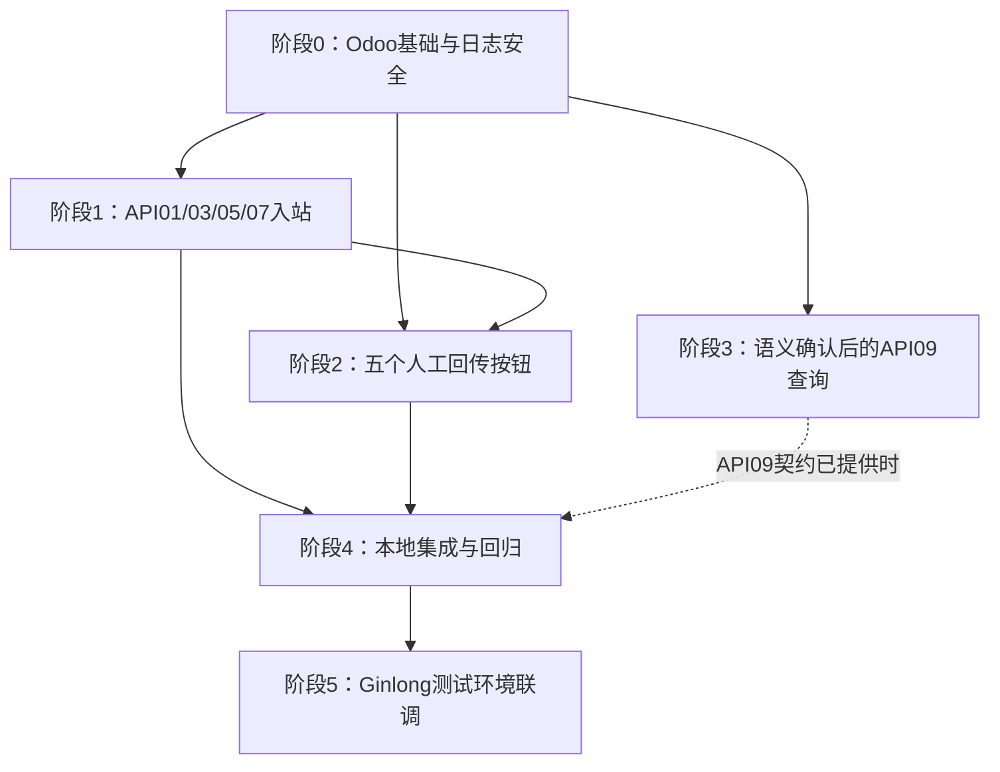

<!-- 本计划 v1.0 于 2026-11-17 按项目用户明确指令冻结。项目模板源同步检查仍为 BLOCKED：仓库缺少 docs/context/cognition/template/Planning/IMPLEMENTATION_PLAN模板.md；用户授权本次在该状态下冻结，检查不记为 Passed。 -->

# ginlong_apis 实施计划

## 文档信息

| 项目 | 内容 |
|---|---|
| 文档 | `IMPLEMENTATION_PLAN_ginlong_apis` |
| 版本 | v1.0 |
| 状态 | Frozen |
| 基线有效性 | VALID：对应 SRS v1.0、TV v0.2、TDD v0.3；阶段 1 的多货主与托盘生命周期设计须先完成上游影响评估 / 更新 |
| 项目 / 模块 | `ginlong_apis` |
| 计划负责人 | 李建强 |
| 编制日期 | 2026-11-16 |
| 基线日期 | 2026-11-17 |
| 批准 / 基线记录 | 李建强（项目用户明确指令“冻结实施计划”）；2026-11-17；批准并冻结 v1.0，模板源同步仍为 BLOCKED，按授权如实保留 |

### 冻结门禁

本计划根据 TDD v0.3（Frozen with Open Items）编排 Ginlong ↔ Odoo 模块工作，并于 2026-11-17 按项目用户明确指令冻结。阶段 1 的各项工作依其批准 CC 执行；对于直接依赖多货主或托盘生命周期能力的场景，先完成适用上游基线评估与更新。CC-GIN-002 v1.0 按其 Human Review 批准范围已完成并关闭，但该关闭不代表上述项目必需需求已完成。

项目 Implementation Plan 模板源同步检查为 `BLOCKED`：仓库中不存在 `docs/context/cognition/template/Planning/IMPLEMENTATION_PLAN模板.md`。本文结构参考技能内置模板。项目用户明确要求冻结本计划；该指令作为本次模板源缺失的授权处置记录，检查状态仍为 `BLOCKED`，不标记为 Passed。

### 首个 CC 门禁清单

- [x] SRS v1.0 已冻结。
- [x] TDD v0.3 已说明 DDD 不适用及其理由。
- [x] TV v0.2 有条件通过；尚未解决的外部依赖已安排到受影响阶段，不阻止 TDD 冻结。
- [x] TDD v0.3 已冻结并保留待决项，且引用下表中的同一 SRS/TV 基线。
- [x] 本计划已由项目用户明确批准并授权基线化（2026-11-17）。
- [x] 各阶段已映射 CC 范围；CC-GIN-001 v1.0 已创建、冻结并授权阶段 0，后续 CC 编号仍是提案。

**门禁结果：** READY——Plan v1.0 已由用户明确冻结并基线化。模板源同步例外如实记录为 BLOCKED；首个 CC-GIN-001 只执行阶段 0。当前各 CC 按其获批范围推进；直接依赖多货主解绑或托盘生命周期的场景须先完成本计划列明的上游影响评估 / 更新。

**依据 / 批准记录：** SRS v1.0、TV v0.2 批准记录、2026-11-16 的 TDD v0.3 冻结记录，以及李建强 2026-11-17 明确冻结 Plan 的指令。项目模板源同步仍为 BLOCKED，不表示检查通过。

## 1. 上游基线

| 依据 / 输入 | 版本 / 编号 | 状态 | 位置 |
|---|---|---|---|
| SRS | ginlong_apis v1.0 | Frozen | [SRS](../requirement/SRS_ginlong_apis.md) |
| DDD | N/A | 不适用；理由见 TDD §0.2 | TDD §0.2 |
| TV / Spike | Ginlong TV v0.2 | 有条件通过；TV 本身未冻结 | [TV 报告](../context/report/TV_ginlong_apis_v0.2.md) |
| TDD | ginlong_apis v0.3 | FROZEN WITH OPEN ITEMS | [TDD](../ginlong_apis/TDD.md) |
| 项目架构认知 | v1.0（2026-11-17） | 用户确认的职责边界与数据流原则；不替代 SRS/TDD/CC | [PROJECT_COGNITION](../context/cognition/PROJECT_COGNITION.md) |
| Odoo / WMS | Odoo 18.0 CE、`worlddepot` | 已检查源码；使用现有开发环境数据库 `odooce_karlrapp`，运行配置待实施时核对 | [TDD §1、§3](../ginlong_apis/TDD.md) |
| 外部字段资料 | Ginlong 集成 V3.1 | 参考资料，不是最终报文契约 | [工作簿](../ginlong_apis/海外WMS与第三方系统集成V3.1.xlsx) |

完整业务闭环为：锦浪 → Odoo 订单 → `karlrapp_gateway` → KR 执行 → Odoo 执行结果 → 用户点击 Odoo 订单按钮 → 锦浪。本计划只覆盖 `ginlong_apis`（锦浪 ↔ Odoo）；`karlrapp_gateway` 负责 Odoo ↔ KR，现有 Odoo WMS 负责订单、库存和业务数据。三个系统的整体验收还需要单独管理的 Gateway 工作；本计划不建立统一集成框架。

## 2. 目标与范围

### 2.1 目标

通过扩展现有 WMS 对象和 API 能力，交付锦浪 ↔ Odoo 闭环中的 Ginlong 部分，使锦浪订单及执行结果经由 Odoo 流转，不重复实现 WMS 订单或库存逻辑。

### 2.2 本计划范围内

- 按 TDD v0.3，将 API01/03/05/07 接入 Odoo 现有订单、产品记录及独立盘点任务 / 采集结果模型。
- API09 为只读库存查询；货主、仓库、产品过滤方式及数量口径确认后再实施。
- 在入库单上设置 API02/04 按钮，在出库单上设置 API06/08 按钮，在盘点单上设置 API10 按钮。按钮从对应单据及关联结果组装请求，同步调用（设定超时），复用现有 API 日志记录结果，并向用户显示执行结果。
- 复用 `worlddepot` 的认证、用户权限、配置和 API 日志；在启用 Ginlong 流量前，修复共享日志中凭据泄露问题。
- 提供本地模拟验证；取得外部资料后，再形成 Ginlong 环境联调证据。

### 2.3 不在本计划范围内

- 实施 `karlrapp_gateway` 或修改其 Odoo ↔ KR 契约。
- 重建 Odoo WMS 订单、拣货、库存、库存调整或产品主数据流程。
- 让 API05/10 使用 `stock.quant` 或过账库存调整。
- 自动回调、后台重试、队列 / Worker、通用集成框架或 Ginlong 专属监控设施。
- 在没有批准的外部依据时自行确定锦浪业务规则、协议细节、API03 方向或 API09 库存口径。

### 2.4 约束

- 遵循 SRS v1.0 和 TDD v0.3（Frozen with Open Items）。
- Ginlong 确认前，API03 暂按 Solis → Odoo 作为开发假设；如确认方向不同，通过 TDD 变更流程调整。
- API02/04/06/08/10 只能由用户操作触发；采用同步调用、合理超时，不自动重试。
- 五个人工回传按钮都放在相应 Odoo 单据上。
- 使用现有 WMS 模型和权限；仅在证明必要时增加字段或 ACL。
- 启用受影响的生产接口或宣称真实联调验收前，先取得相应外部协议资料。

## 3. 开工前提

| 前提 | 所需状态 / 证据 | 负责人 | 优先级 | 状态 |
|---|---|---|---|---|
| SRS / TV / TDD 基线 | SRS v1.0 Frozen、TV v0.2 有条件通过、TDD v0.3 Frozen with Open Items | 项目负责人 | P0 | 已满足 |
| Odoo 运行环境 | 核对 Odoo 18.0、现有 `venv` 中的 Python、PostgreSQL 版本及 addon 路径；复用项目目录下的 `venv`，不另建虚拟环境 | Odoo 管理员 / 实施人员 | P0 | WorldDepot / Ginlong 已通过 Odoo Shell ORM 安装及升级；现有 venv Python 3.11.9；manifest 不声明 `stock_barcode`，扫码扩展导入按用户授权停用，扫码模块仍 `uninstallable`。真实 API Secret 哈希已由用户授权补齐 bcrypt 依赖并通过 Odoo ORM 验证 |
| Odoo 开发环境 | 使用现有开发环境及数据库 `odooce_karlrapp`；按项目工作流在该环境实施和验证，不另建隔离数据库 | Odoo 管理员 / 实施人员 | P0 | 已通过现有 `odoo.conf` 的 Odoo Shell ORM 连接；未新建数据库或环境。`worlddepot` / `ginlong_apis` 均 installed |
| 多货主订单设计 | Ginlong 项目可有多个货主；货主档案复用 `res.partner`，订单不能只从项目 Owner 推导货主。阶段 1 前完成上游文档影响评估 / 更新 | 项目负责人 / WMS 负责人 | P0（阶段 1） | 用户已确认可修改现有订单模型；字段设计须先纳入上游基线 |
| 托盘生命周期 | 记录托盘标识及入库、库内移动 / 拆装、出库等事件；先核对现有 Package / Stock Move 历史覆盖情况 | WMS 负责人 / 实施人员 | P0（阶段 1/4） | 用户已明确必须记录；受影响阶段前纳入上游文档和验收标准 |
| 现有认证和 ACL | 在目标开发库确认 API 用户认证及 WMS 用户组的实际效果 | 实施人员 | P0 | 真实 API User Secret 哈希/正反验证、既有认证 controller、Token validator 已通过 Odoo Shell ORM；7 项组件测试通过。ACL 权限矩阵未在 CC-GIN-001 范围验证，留待受影响业务阶段 |
| 共享 API 日志安全修复 | 复现并修复 Secret/Token 泄露；确认请求、响应及异常日志不暴露凭据 | 实施人员 | P0 | 真实 controller/logger 调用及 Odoo 标准组件测试 7 项通过；真实 Odoo Secret 哈希和认证检查通过；现有日志未见测试凭据。详见 ATR-GIN-001；HTTP 网络 E2E 未执行 |
| Ginlong 报文契约 | 提供带版本的 URL、方法、认证、必填字段、响应语义、错误规则、测试端点和凭据 | 锦浪 / 项目负责人 | 真实联调 P0；独立字段映射工作不受阻 | 待提供 |
| API03 方向 | 书面确认 Solis → Odoo 或实际方向 | 锦浪 / 项目负责人 | 生产启用 P0 | 待确认；A-003 为开发假设 |
| API05/10 行为 | 确认删除 / action 规则，以及整单或部分结果提交语义 | 锦浪 / 项目负责人 | 对应行为 P0 | 待确认 |
| API07 产品规则 | 确认必填字段及创建 / 更新行为，并遵从现有 WMS 产品规则 | 锦浪 / WMS 负责人 | API07 生产验收 P0 | 待确认 |
| API09 查询语义 | 确认货主 / 仓库 / 产品过滤、库位、数量口径、预留 / 状态处理及分页 | 锦浪 / WMS 负责人 | API09 实施验收 P0 | 待确认 |
| Gateway 衔接 | 完整闭环需要 `karlrapp_gateway` 单独提供 Odoo ↔ KR 消息行为 | Gateway 负责人 | 三系统端到端验收 P1 | 独立模块依赖，不阻塞 Ginlong 阶段 |

如 P0 外部前提尚未满足，只继续不依赖该信息的本地模拟和实施工作。受影响阶段的真实联调保持阻塞，不推断或补造契约。

## 4. 实施阶段

### 阶段 0：Odoo 公共基础与日志安全

**目标**

复用 WMS 认证、权限、配置和日志，准备轻量的 addon 接入点。

**输入与依赖**

- SRS v1.0 和 TDD v0.3。
- 现有 Odoo 18.0 开发环境及数据库 `odooce_karlrapp`；按项目工作流直接在此环境开展工作。
- 现有 `worlddepot` API 日志和认证行为。

**交付物**

- 最小化 `ginlong_apis` addon 基础结构，以及必要的模型、视图和访问配置。
- 修复共享 API 日志中的凭据和 Token 泄露；只有在现有字段无法表达必要信息时才补充 API / 单据查找字段。
- 复用现有 WMS 权限和配置；发现缺口时先记录，再做最小范围扩展。

**验收门槛**

- addon 可在 `odooce_karlrapp` 开发环境安装 / 升级。
- 现有 WMS 行为保持正常。
- Secret、Token、Authorization 和签名值不会出现在数据库日志、应用日志或用户错误提示中。

**验证证据**

- 安装 / 升级结果、针对日志凭据保护的验证，以及现有 API 日志路径的回归证据；按项目证据流程记录。

**CC 对应关系**

- CC-GIN-001 v1.0 Closed：addon 基础、复用边界及共享 API 日志安全修复；关闭依据见 FR-GIN-001 v1.0。

**当前执行状态（2026-11-17）：** CC-GIN-001 v1.0 已关闭；CC-GIN-002 v1.0 已依据 FR-GIN-002 v1.0（Closure SATISFIED；Human Review APPROVED）关闭，ATR-GIN-002 最终有效基线为 ATR-RUN-009，未重跑。CC-GIN-003 v1.0 已由 Human Review APPROVED 并冻结，授权编码及自动化/集成测试；范围包括 API01/03/05/07 入站幂等与限流、UPDATE/DELETE 及五个人工回传接口。实施记录见 [IHR-GIN-003 v0.2](IHR-GIN-003.md)，测试记录见 [ATR-GIN-003 v0.2](ATR-GIN-003.md)。最新基线 15 项 Odoo 自动化通过；真实单进程 HTTP 验证观察到 200/429、`Retry-After` 及次秒幂等重放。五个人工回传、真实多 Worker 100/s 和提交后响应丢失仍未通过/未运行；workers=4 子进程因 `zope.interface` distribution 解析错误未能启动，详见 ATR。Ginlong 外部协议、API03 正式方向、API07 DELETE 契约仍待确认。完整 WMS 流程及模板同步保持 BLOCKED/NOT RUN；模板同步按已批准例外仍为 BLOCKED，不伪记通过。本段仅记录执行状态，不改变 Plan v1.0 规划基线。

**CC-GIN-001 关闭及下一阶段门禁（2026-11-17）：** 李建强 Human Review `APPROVED`；FR-GIN-001 v1.0 正式关闭；CC-GIN-001 v1.0 状态为 Closed。已允许进入 CC-GIN-002 草拟和评审准备。当前 SRS v1.0 未纳入订单货主与项目解绑及托盘生命周期要求，TDD v0.3 也未完成这些设计；故 CC-GIN-002 Draft 明确保留这两项，但受影响条款在上游 SRS/TDD/Plan 更新批准并重新基线化、CC 冻结之前不得编码实施。其他不依赖该变更的内容也须以 CC-GIN-002 最终冻结范围为准。HTTP E2E、WMS 流程写入验证和模板同步继续保留原未执行/BLOCKED 状态。

**业务数据流澄清（2026-11-17）：** 锦浪下达业务指令 → Odoo 接收入库 / 出库订单 → Odoo 转发给 Karl Rapp → KR 执行实际仓库作业 → Odoo 现有 WMS 使用 `stock.picking` 记录执行结果 → 用户点击 Odoo 订单按钮回传执行结果给锦浪。此处记录用户确认的既有职责边界，不改变 SRS / TDD 基线；后续实施继续复用 WMS，不重做仓库作业。

### 阶段 1：锦浪入站订单、产品和盘点任务

**目标**

按现有 Odoo 模型及独立盘点模型，实现可本地模拟的 API01/03/05/07 入站处理。

**输入与依赖**

- 阶段 0 验收通过。
- 已确认的 SRS 字段来源及 V3.1 参考字段。
- Ginlong 报文细节仍属外部依赖；本地模拟报文不得标注为生产契约。

**交付物**

- API01 映射到现有入库单。
- API03 在 Solis → Odoo 的 A-003 开发假设下映射到现有出库单。
- 订单货主脱离项目货主强制绑定是项目必需需求；CC-GIN-002 v1.0 未包含该模型调整。须安排独立 CC 或后续适当阶段并完成适用上游基线；不能将其标记为本阶段已完成，也不阻止 CC-GIN-002 已批准范围的关闭。直接依赖该能力的业务场景在完成前受限。
- API05 保存独立盘点任务及明细，不接触库存模型。
- API07 更新现有 `product.product`，只增加必要的继承字段。

**验收门槛**

- 本地模拟处理能创建 / 更新目标现有订单和产品记录，并保存独立盘点数据。
- 不增加货主与产品的归属规则。
- API05 不读取或写入 `stock.quant`、`stock.move`，也不执行库存调整。
- 托盘生命周期记录是项目必需需求，但未纳入 CC-GIN-002 验收；须安排后续独立 CC/适当阶段。直接依赖完整生命周期语义的场景在相应基线与实施完成前受限。API05/10 盘点仍独立于库存账。
- 依赖外部确认的行为在确认前保持禁用或明确标为待处理。

**验证证据**

- 本地请求 / 响应样例、ORM 证据、字段映射结果，以及证明盘点数据隔离的源码 / 行为检查。

**CC 对应关系**

- [CC-GIN-002 v1.0 Closed](CC-GIN-002.md)：API01/03/05/07 本地范围完成；ATR-RUN-009 最终有效基线。货主解绑及托盘生命周期仍为项目必需后续工作，未纳入此 CC 完成范围。
- [CC-GIN-003 v1.0 Frozen with Open Items](CC-GIN-003.md)：继续覆盖入站 API 的幂等/限流及 UPDATE/DELETE 行为；验收按 CC-GIN-003 §6.2 单独记录。此 CC 不改变其他 WMS 模型全局唯一规则。

### 阶段 2：单据上的人工回传按钮

**目标**

在对应 Odoo 单据上实现五个人工回传操作。

**输入与依赖**

- 阶段 0 的日志与安全准备。
- 现有入库单 / 出库单模型及 API05/10 盘点模型。
- 生产验收需要 Ginlong 响应契约；此之前可用模拟响应。

**交付物**

- 入库单上的 API02/04 按钮。
- 出库单上的 API06/08 按钮。
- 盘点单上的 API10 按钮，Payload 从关联采集结果组装。
- 同步发出一次请求、设置合理超时、不自动重试；在现有 API 日志中记录请求 / 响应 / 错误，并在 Odoo 页面显示结果。

**验收门槛**

- 每次调用只能由用户点击按钮触发。
- 每次点击只发出一个 HTTP 请求；状态变化、定时任务、安装 / 升级或服务重启均不得触发 Ginlong 调用。
- 成功、HTTP 错误及超时 / 结果未知均有记录并显示，且不泄露凭据。
- 不增加确认弹窗或未经批准的业务状态条件。

**验证证据**

- 每个按钮的模拟 HTTP 断言，以及手工 UI 证据，证明按钮位置、权限、请求结果和日志记录。

**CC 对应关系**

- [CC-GIN-003 v1.0 Frozen with Open Items](CC-GIN-003.md)：Human Review APPROVED；已授权实施及自动化/集成测试。覆盖五个人工回传接口；其验收与入站幂等/限流结果分开记录。Ginlong 协议 Open Items 继续保留。

### 阶段 3：API09 只读库存查询

**目标**

外部库存查询语义有书面依据后再实施 API09。

**输入与依赖**

- 阶段 0 的权限与日志能力。
- Ginlong 对过滤条件、库位、数量口径、预留 / 状态及分页的确认。

**交付物**

- 使用确认后的条件和访问范围，只读查询 Odoo 现有库存数据。
- 按确认契约返回结果，并写入现有 API 日志。

**验收门槛**

- 查询过滤和数量口径符合批准的契约。
- 查询不写库存、不做调整，也不添加货主与产品的归属规则。
- 如语义仍未确定，本阶段保持阻塞，不宣称数量结果已符合最终要求。

**验证证据**

- 在 `odooce_karlrapp` 开发环境使用测试记录，与双方确认的数量样例比对，并提供查询未发生写入的证据。

**CC 对应关系**

- 拟议 CC-GIN-004：语义确认后实现 API09 只读库存查询。

### 阶段 4：本地集成与回归验收

**目标**

联合验证 Ginlong 模块的本地数据路径，同时确保现有 WMS 行为不回退。

**输入与依赖**

- 阶段 0–3；若 API09 契约未提供，可明确保持 API09 阻塞。
- 本地模拟端点和 `odooce_karlrapp` 开发环境中的测试记录。

**交付物**

- 所有不依赖未决外部契约的接口映射及五个按钮的本地模拟证据。
- 权限、日志凭据保护、超时 / 不重试及盘点隔离的验证证据。
- 托盘从入库到出库的标识连续性及移动历史证据；若标准 Package / Stock Move 记录不完整，暂停受影响工作并更新上游设计，不临时增加第二套托盘台账。
- 更新各适用 SRS FR 和 TDD 约束的追踪记录。

**验收门槛**

- 每个可在本地验证的场景都有真实证据，并准确记录 Passed / Failed / Blocked / Not Run 状态。
- 每个已收货托盘能沿稳定标识追溯其收货、库内移动 / 拆装及出库事件和关联单据；数据通过标准 WMS 库存移动记录，不手工写入 `stock.quant`。
- 未执行的计划不得记为通过。
- 每个受外部信息影响而阻塞的项目，都注明缺失契约和责任方。

**验证证据**

- Odoo 测试 / ORM 结果、模拟 HTTP 结果、手工 UI 证据及回归报告。

**CC 对应关系**

- 拟议 CC-GIN-005：本地集成与 WMS 回归验收。

### 阶段 5：Ginlong 测试环境联调

**目标**

取得外部契约和测试环境后，验证实际 Ginlong 请求 / 响应行为。

**输入与依赖**

- Ginlong 批准的带版本接口契约、测试端点、凭据和测试数据。
- API03 方向确认，以及 API09 的库存语义确认（仅适用于相应接口）。

**交付物**

- 按接口形成真实联调证据；尚不支持或仍未确认的接口明确排除并记录。
- 按确认结果处理外部响应语义、重复 / 结果未知及批次行为。

**验收门槛**

- 实际 Ginlong 响应符合批准契约，Odoo 处理结果及日志正确。
- 缺少契约或必要验收证据的接口不得启用生产流量。

**验证证据**

- 带日期的 Ginlong 测试记录，以及已脱敏的请求 / 结果日志引用。

**CC 对应关系**

- 拟议 CC-GIN-006：Ginlong 环境联调及接口级验收。

## 5. 阶段顺序与依赖关系

**关键路径：** 阶段 0 → 阶段 1/2 → 阶段 4 → 阶段 5。API09 是独立依赖分支，不应阻塞无关的本地字段映射或按钮工作。

**并行工作与约束：** 阶段 1、2 可在阶段 0 后分别安排，但按钮依赖单据最终字段和关联数据。API09 只有在取得数量 / 过滤契约后才能继续。`karlrapp_gateway` 单独管理；完整三系统闭环需等待其独立验收证据。

## 6. 里程碑

| 里程碑 | 包含阶段 / 交付物 | 退出条件与证据 | 目标 / 状态 |
|---|---|---|---|
| M1——实施准备就绪 | 计划批准、阶段 0 | 计划获批并建立基线；开发环境可用且共享日志安全通过验证 | 2026-11-17；安装 / 升级、7 项 Odoo 测试及真实 Odoo Secret/认证验证通过；WMS 只读 ORM 冒烟通过，未运行单据/库存写入流程；FR-GIN-001 v1.0 Human Review APPROVED，CC-GIN-001 Closed |
| M2——Ginlong 本地流程 | 阶段 1、2 | 四个入站接口及五个手动按钮各自完成 CC 自动化/ORM 验收；API07 100 次/秒真实多 Worker 限流验证满足 CC 标准 | 2026-11-17；CC-GIN-002 v1.0 Closed（ATR-RUN-009）；CC-GIN-003 v1.0 Frozen/实施中（最新 15 项 Odoo 自动化通过，真实单进程 429/重放通过）；回传、多 Worker 和事务响应丢失仍未完成，M2 未完成 |
| M3——库存查询 | 阶段 3 | API09 契约获批，且只读结果符合确认样例 | 日期待定；受外部语义阻塞 |
| M4——Ginlong 联调 | 阶段 4、5 | 本地回归证据及逐接口 Ginlong 测试证据齐备 | 日期待定；需要外部资料 |
| M5——三系统闭环 | 本计划与独立的 `karlrapp_gateway` 计划 | 基于现有 WMS 单据，完成 Ginlong ↔ Odoo 与 Odoo ↔ KR 验收证据核对 | 日期待定；不属于本计划实施范围 |

目前尚不制定工期或工作量估算，因为实施人员、运行环境准备情况和外部交付时间均未确定。

## 7. 验收与验证矩阵

| 需求 / 设计义务 / TV 项目 | 计划阶段 | 验收标准 | 验证方法与证据 | CC / FR | 状态 |
|---|---|---|---|---|---|
| SRS FR-GIN-001 / API01 | 阶段 1 | 入库单字段映射到现有 WMS 单据 | 本地模拟 + ORM 证据 | CC-GIN-002 / CC-TEST-001 | SATISFIED；ATR-RUN-009 |
| SRS FR-GIN-003 / API03、A-003 | 阶段 1 | 按当前 Solis→Odoo 假设映射出库单 | 本地模拟；仍明确标记方向未获外部确认 | CC-GIN-002 / CC-TEST-002 | 本地范围 SATISFIED；外部方向仍待确认；ATR-RUN-009 |
| SRS FR-GIN-005 / API05 | 阶段 1 | 独立盘点任务 / 明细可保存，不产生库存移动 | ORM 及明确的无库存写入证据 | CC-GIN-002 / CC-TEST-003 | SATISFIED；ATR-RUN-009 |
| SRS FR-GIN-007 / API07 | 阶段 1 | 按批准字段复用 / 扩展现有 `product.product` | 对照 WMS 产品主数据行为的 ORM 证据 | CC-GIN-002 / CC-TEST-004 | 本地范围 SATISFIED；外部产品契约仍待确认；ATR-RUN-009 |
| 项目用户决定：Ginlong 可有多个货主 | 后续阶段 | 订单货主按接口数据独立指定，不只由项目 Owner 决定；货主档案复用既有伙伴能力 | 多货主场景与现有订单回归；具体实现先纳入适用上游基线 | 后续独立 CC / 测试编号待分配 | 项目必需；未完成，不属于 CC-GIN-002 关闭范围 |
| SRS FR-GIN-002/004/006/008/010 | 阶段 2 | 五个按钮位于正确的入库单、出库单或盘点单上，点击后人工发送一次 | 模拟 HTTP 与 UI 证据 | CC-GIN-003 v1.0 / CC-TEST-001–007 | 已冻结并授权；未实施，CC-TEST-001–007 BLOCKED，见 ATR-GIN-003 |
| 项目用户决定：入站幂等与限流、UPDATE/DELETE | 阶段 1/2 | API01/03/05/07 按接口键和指纹幂等；各 API 独立限流；订单 DELETE 仅状态取消且重复删除成功；UPDATE 复用现有模型逻辑 | ORM/自动化及真实多 Worker HTTP；API07 限流 100 次/秒并记录冲突/重试/错误 | CC-GIN-003 v1.0 / CC-TEST-008–023 | 最新 15 项 Odoo 自动化通过，部分测试 PASS；多 Worker/API07 100/s 与响应丢失未通过/未运行，见 ATR-GIN-003；Open Items 依 CC 保留 |
| SRS FR-GIN-010 / API10 | 阶段 2 | API10 Payload 来源于盘点单采集结果，不进行库存过账 | 模拟 HTTP + 库存隔离证据 | CC-GIN-003 / TEST-GIN-004 | 计划中；批次语义待确认 |
| SRS FR-GIN-009 / API09 | 阶段 3 | 只读查询符合已确认过滤条件和数量口径 | 经批准的样例及开发环境数据库查询结果对照 | CC-GIN-004 / TEST-GIN-006 | 受锦浪语义阻塞 |
| SRS NFR-GIN-SEC-001/002 | 阶段 0/4 | 复用现有认证 / 权限，凭据不泄露 | 认证 / ACL 场景及日志检查 | CC-GIN-001/005 / TEST-GIN-009/010 | 真实 API Secret ORM 哈希/验证及既有认证 controller 通过；日志保护和 7 项 Odoo 测试通过。ACL 授权矩阵不属于本 CC 验收范围，后续业务阶段核对，见 ATR-GIN-001 |
| SRS NFR-GIN-AUD-001 | 阶段 0/2/4 | 现有日志记录相关调用的请求、响应 / 错误及结果 | 检查现有日志字段；仅补充经证明缺少的字段 | CC-GIN-001/003/005 / TEST-GIN-012 | API log 模型已注册；真实 ORM 创建 / 读取与组件测试通过并回滚；完整 HTTP / WMS 集成回归未运行，见 ATR-GIN-001 |
| SRS NFR-GIN-REL-001 | 阶段 2/4 | 一次点击只发送一次；不自动重试；结果未知时向用户显示并记录 | 超时及重复点击模拟场景 | CC-GIN-003/005 / TEST-GIN-008 | 计划中 |
| TDD T-WMS-001 / TV 复用结论 | 阶段 1–4 | 订单和库存行为仍由现有 WMS 负责，不重复开发流程 | 代码审查及回归证据 | 所有实施 CC / FR | 计划中 |
| TDD T-COUNT-001 | 阶段 1/2/4 | API05/10 不读写 `stock.quant` / `stock.move` | 源码检查及隔离测试证据 | CC-GIN-002/003/005 / TEST-GIN-003/004 | 计划中 |
| 项目用户决定：托盘生命周期必须留痕 | 后续适当阶段 | 每个托盘沿稳定标识追溯收货、库内移动 / 拆装和出库事件、产品数量、时间及关联单据；正常库存移动使用标准 WMS 流程 | Package / Stock Move 事件链核对；盘点 API05/10 保持独立，不直接修改 `stock.quant` | 后续独立 CC / 测试编号待分配 | 项目必需；未完成，不属于 CC-GIN-002 关闭范围 |
| TV v0.2 有条件项 | 阶段 0–5 | 受影响的生产联调前，每项均已验证或有获批且范围明确的处置方式 | 将每项 TV 待决内容对应到外部输入、计划阶段、证据和负责人 | CC-GIN-001–006 | 计划中 |

## 8. 质量与验证策略

| 验证领域 | 适用范围 | 所需证据 / 门槛 |
|---|---|---|
| 自动化 / 单元 / ORM | 字段映射、盘点模型、API 日志、按钮、库存查询 | 在现有开发环境数据库 `odooce_karlrapp` 执行的 Odoo 验证结果，并附到对应 CC/ATR |
| 权限与安全 | 现有 API 用户、WMS 用户组、新盘点 ACL、共享日志 | 有权限 / 无权限场景；数据库 / 应用日志及 UI 错误不含凭据 |
| 浏览器 / 端到端 / 人工 | 五个单据回传按钮 | 人工确认按钮位置、访问权限、点击、响应显示和日志记录 |
| 性能 / 容量 | Payload 大小及 API09 结果量 | 仅在 Ginlong 提供容量 / SLA 要求时设定门槛；否则记录测量结果，不自行设定阈值 |
| 升级 / 迁移 / 回滚 | 新 addon、继承字段、盘点模型、共享日志变更 | 按项目开发环境工作流验证安装 / 升级、记录回滚方式，并回归现有 WMS / API 日志；不要求另建隔离副本 |
| 最终基线回归 | 现有 WMS 与 Ginlong 路由 / 按钮 | 在最终代码基线上重跑适用的 `worlddepot` 测试和 Ginlong 测试；明确标记受外部资料阻塞的接口 |
| 三系统完整闭环 | Ginlong 模块与 `karlrapp_gateway` | 两个模块分别完成批准的验收后，基于现有 Odoo 单据 / 结果执行联合场景；这不阻塞本模块的独立本地模拟 |

## 9. 风险与应对

| 风险 | 概率 / 影响 | 应对措施 | 备用方案 / 决策负责人 | 状态 |
|---|---|---|---|---|
| 缺少 Ginlong 报文契约 | 高 / 对真实联调影响高 | 只继续已确认字段映射和模拟工作；契约获批前不启用生产路由 | 锦浪 / 项目负责人；推迟受影响接口 | 未解决 |
| 多货主与托盘生命周期尚未纳入当前冻结的需求 / 技术验收基线 | 高 / 阶段 1 设计及验收不完整 | 阶段 1 前完成 SRS/TDD 影响评估并更新适用基线；CC-GIN-001 不触及订单货主及托盘操作 | 项目负责人 / WMS 负责人 | 阶段 1 门禁 |
| API03 方向与 A-003 不同 | 中 / 高 | 将当前入站假设限制在 API03 内；生产启用前取得书面方向确认 | 锦浪 / 项目负责人；必要时修订 TDD | 未解决 |
| API09 数量语义未定 | 高 / 影响库存响应 | 过滤、库位和数量口径确认前不实现最终数量算法 | WMS 负责人 / 锦浪；推迟 API09 阶段 | 未解决 |
| 共享 API 日志暴露凭据 | 已从源码发现风险 / 高 | Ginlong 流量启用前修复共享日志路径并验证相关现有路径 | 安全负责人 / 项目负责人；阻止接口启用 | 代码、7 项组件测试、真实 ORM Secret/controller 认证和日志检查通过；无 Ginlong 联调 / HTTP 网络 E2E |
| 现有 venv 缺少 bcrypt backend | ATR-RUN-004 实测 / 影响 API User Secret 创建与校验 | 按用户授权新增独立 requirements 并在现有 venv 安装，随后通过 Odoo ORM 复测 | 项目负责人 / Odoo 管理员 | 已解决；ATR-RUN-005 PASS |
| 超时后对端处理结果未知 | 中 / 高 | 使用有界同步调用，记录并显示未知结果，不自动重试；遵循确认后的重复 / 未知结果规则 | 项目负责人 / 锦浪；用户按批准规则处理 | 未解决 |
| TDD / Plan 模板源同步受阻 | 已确认 / 流程影响 | 如实保留 `BLOCKED`；草案参考技能内置模板；记录用户直接授权，不声称同步通过 | 项目负责人；日后恢复项目模板源 | 未解决 |
| Odoo ↔ KR Gateway 尚未就绪 | 未知 / 影响端到端验收较高 | 保持 Gateway 范围独立；待其基线就绪后安排完整闭环证据 | `karlrapp_gateway` 负责人 | 独立模块依赖 |

## 10. 资源与环境

| 资源 / 环境 | 要求 | 负责人 | 可用情况 / 状态 |
|---|---|---|---|
| Odoo 18.0 开发环境 | 使用现有数据库 `odooce_karlrapp`；直接按项目工作流验证，不另建隔离数据库 | Odoo 管理员 | 已指定 |
| 项目现有 Python 虚拟环境 | 复用仓库目录下已有的 `venv`；核对其 Python 版本和项目启动方式，不新建另一套虚拟环境 | 实施人员 | `venv` 已存在；版本及启动方式待核对 |
| PostgreSQL 运行环境 | 使用当前 Odoo 开发环境连接的 PostgreSQL；核对实际版本及连接配置 | Odoo 管理员 | 版本待核对 |
| `worlddepot` 源码及 WMS 测试数据 | 入库 / 出库单、产品、采集数据及权限 | WMS 负责人 / 实施人员 | 源码可用；测试数据方案待定 |
| Ginlong API 文档 / 测试端点 / 凭据 | 有版本的契约及测试访问 | 锦浪 / 项目负责人 | 尚未提供 |
| 现有 API 日志 / 认证 | 源码、测试场景及当前 Odoo Runtime | 实施人员 | 现有 logger/controller、真实 Odoo Secret 哈希与认证、Token 校验及 7 项 Odoo 组件测试通过；独立 requirements 已记录 |
| `karlrapp_gateway` | 完整闭环所需的独立 Odoo ↔ KR 工作流 | Gateway 负责人 | 独立项目 / 模块；本计划尚未评估其状态 |

## 11. 变更控制

- SRS 或 TDD 发生变更时，返回对应上游文档处理；继续前重新评估受影响阶段、验收项、依赖和拟议 CC。
- 完整闭环的模块边界必须保持：`ginlong_apis` = 锦浪 ↔ Odoo，`karlrapp_gateway` = Odoo ↔ KR，现有 Odoo WMS = 订单 / 库存 / 业务数据。
- 实施中发现与 SRS/TDD 冲突时，暂停受影响阶段并按相应变更流程更新上游依据，不得在 CC 中自行消解。
- 每个 CC 必须引用其阶段和验收项。CC-GIN-001 已由拟议映射回填为实际冻结 CC；其余 CC 编号仍为拟议编号，创建后再回填实际引用。
- Ginlong 或 KR 协议变化只影响相应模块契约，不得将统一集成框架作为默认补救方案。

## 12. 交付物与项目移交

| 交付物 | 计划阶段 | 验收证据 | 最终位置 / 状态 |
|---|---|---|---|
| 使用现有 WMS 模型的 `ginlong_apis` addon | 阶段 0–3 | CC/FR、Odoo 安装 / 升级及回归证据 | `mymodules/ginlong_apis/`；CC-GIN-001 v1.0 Closed；CC-GIN-002 v1.0 Closed（FR-GIN-002 v1.0；ATR-RUN-009）；CC-GIN-003 v1.0 Frozen with Open Items，实施中 |
| Ginlong 流量使用的安全共享 API 日志 | 阶段 0 | 凭据不可见的验证证据及现有日志回归证据 | `mymodules/worlddepot/`；阶段 0 安全修复和 ATR 完成，CC-GIN-001 v1.0 Closed（FR-GIN-001 v1.0） |
| 五个单据上的人工回传按钮 | 阶段 2 | 模拟 HTTP、UI 和 API 日志证据 | `mymodules/ginlong_apis/`；尚未开始 |
| 本地模拟报告 | 阶段 4 | 逐接口执行结果及准确状态 | `docs/context/report/`；计划中 |
| Ginlong 真实联调证据 | 阶段 5 | 契约、端点测试记录、脱敏请求 / 响应证据 | `docs/context/report/`；受外部资料阻塞 |
| 三系统端到端闭环证据 | 单独联合活动 | Ginlong 与 `karlrapp_gateway` 已批准的验收证据，并基于 Odoo 记录核对 | 项目收尾资料；不属于本计划范围 |

项目结束时，应按实际 CC、FR 和 PVR 证据逐项核对本计划各阶段及交付物。本计划 v1.0 规划基线保持冻结；执行状态以对应 IHR/ATR/FR 为准。CC-GIN-002 只关闭其明确的四接口本地验收范围；CC-GIN-003 v1.0 已冻结并进入实施，实际完成情况以其分区 IHR/ATR/FR 为准。货主解绑、托盘生命周期及真实外部联调仍属于未完成工作。

## 13. 待决事项与后续跟踪

| 编号 | 问题 / 待办事项 | 阻塞阶段 | 负责人 | 期限 / 状态 |
|---|---|---|---|---|
| OPEN-GIN-API-DOCS | 提供有版本的端点、方法、认证、请求 / 响应、错误及测试环境资料 | 阶段 5 及各受影响的生产接口 | 锦浪 / 项目负责人 | 待提供 |
| OPEN-GIN-API03 | 确认 API03 方向 | 阶段 5 / API03 生产启用 | 锦浪 / 项目负责人 | 待确认；A-003 仍为开发假设 |
| OPEN-GIN-API10 | 确认 API10 整单 / 部分批次语义及外部 action | 阶段 2/5 的相关部分 | 锦浪 / 项目负责人 | 待确认；API05 本地 DELETE 依 CC-GIN-003 改为状态取消，不物理删除 |
| OPEN-GIN-API07 | 确认产品字段、创建 / 更新行为及是否存在产品 DELETE 契约 | API07 生产验收 | 锦浪 / WMS 负责人 | 待确认；本 CC 不擅自物理删除或归档产品 |
| OPEN-GIN-MULTI-OWNER | 评估并记录多货主在订单模型中的字段来源，确保 Owner 不再只由项目唯一货主决定；更新适用 SRS/TDD 基线 | 后续独立 CC / 适当阶段（CC-GIN-002 已关闭且不含此项） | 项目负责人 / WMS 负责人 | 用户已确认可修改现有订单模型；必需需求，尚未完成/基线化 |
| OPEN-GIN-PALLET-LIFECYCLE | 明确托盘从入库、库内移动 / 拆装到出库的事件追踪及验收；验证标准 Package / Stock Move 记录完整性并更新适用 SRS/TDD 基线 | 后续独立 CC / 适当阶段（CC-GIN-002 已关闭且不含此项） | 项目负责人 / WMS 负责人 | 用户要求必须记录；必需需求，尚未完成/基线化 |
| OPEN-GIN-API09 | 确认货主 / 仓库 / 产品过滤、库位范围、数量口径和分页 | 阶段 3 | 锦浪 / WMS 负责人 | 待确认 |
| OPEN-GIN-REPEAT | 确认重复请求、幂等、超时 / 结果未知处理 | 真实回传验收 | 锦浪 / 项目负责人 | 待确认 |
| OPEN-ODOO-RUNTIME | 复用当前 Odoo / `venv`，确认 API User Secret 认证运行依赖 | 阶段 0 | Odoo 管理员 / 实施人员 | Closed：按用户授权在既有 venv 安装独立 bcrypt requirements；真实 Odoo Secret/认证验证通过。扫码导入按授权停用，未安装扫码模块 |
| OPEN-PLAN-APPROVAL | 首个 CC 前评审并批准 / 建立本计划基线 | 所有实施阶段 | 项目负责人 | 已由用户于 2026-11-17 明确授权并冻结为 v1.0 |
| OPEN-PLAN-TEMPLATE | 恢复项目 Implementation Plan 模板源并重新执行同步检查 | 后续要求模板源同步通过的修订前 | 项目负责人 | BLOCKED；本次冻结由用户明确授权，检查未标为通过 |

## 14. 追踪关系

### 14.1 依据到计划

| SRS / DDD / TDD / TV 依据 | 计划阶段 | 拟议验收 / 证据 |
|---|---|---|
| SRS FR-GIN-001、FR-GIN-003、FR-GIN-005、FR-GIN-007 | 阶段 1 | 复用现有入库 / 出库 / 产品对象并保存独立盘点数据；CC-GIN-002 |
| SRS FR-GIN-002/004/006/008/010 | 阶段 2 | 五个单据按钮；人工同步调用及现有日志；CC-GIN-003 |
| SRS FR-GIN-009 | 阶段 3 | 库存语义确认后的只读查询；CC-GIN-004 |
| SRS NFR-GIN-SEC-001/002 | 阶段 0/4 | 复用现有认证 / 权限并验证日志不含凭据；CC-GIN-001/005 |
| SRS NFR-GIN-AUD-001 | 阶段 0/2/4 | 现有 API 日志覆盖请求 / 响应 / 错误；CC-GIN-001/003/005 |
| SRS NFR-GIN-REL-001 | 阶段 2/4 | 人工请求只发送一次、不自动重试，并向用户呈现未知结果；CC-GIN-003/005 |
| TDD §§0.4、3–8、12–18 | 阶段 0–5 | 复用边界、Payload 映射、按钮位置、安全、日志及外部待决项 |
| TV v0.2 字段映射 / 安全 / 日志发现 | 阶段 0–5 | 只实现已确认的复用能力；验证日志安全和盘点隔离 |
| 项目用户 2026-11-16/17 决定 | 阶段 1/2/4 | 支持多个 Ginlong 货主并保留托盘生命周期记录；受影响阶段启动前完成上游基线评估 |

### 14.2 计划到编码收尾

| 计划阶段 / 交付物 | 拟议 CC | IHR / ATR / HVR | FR | PVR 证据 |
|---|---|---|---|---|
| 阶段 0：基础与日志安全 | CC-GIN-001 v1.0 Closed | 安装/升级与 Odoo runner 7 项通过；真实 ORM Secret/认证、Token validator、logger 安全及 WMS 只读模型查询通过；未执行 HTTP 网络或 WMS 写入流程 | NFR-GIN-SEC-001/002、NFR-GIN-AUD-001 | ATR-RUN-005；FR-GIN-001 v1.0 Human Review APPROVED；CC 已关闭 |
| 阶段 1：入站订单 / 产品 / 盘点任务 | CC-GIN-002 v1.0 Closed | ATR-RUN-009；六项自动化通过；仅关闭 CC 明确的 API01/03/05/07 本地范围 | FR-GIN-001/003/005/007 | 已关闭；货主解耦及托盘生命周期仍为后续必需需求，不得标记完成 |
| 阶段 1/2：入站保护/订单操作及单据人工回传 | [CC-GIN-003 v1.0 Frozen with Open Items](CC-GIN-003.md) | Human Review APPROVED；实施与自动化/集成测试已授权；回传与入站分区记录结果 | FR-GIN-002/004/006/008/010 及用户确认的幂等/限流/订单操作规则 | 实施中；IHR-GIN-003 v0.2、ATR-GIN-003 v0.2；15 项自动化通过，五个人工回传及 API07 100/s 多 Worker 验收未完成；外部 Open Items 保留 |
| 阶段 3：API09 查询 | CC-GIN-004 | 阶段 1 与上游更新后分配 | FR-GIN-009 | 待补；外部语义门禁 |
| 阶段 4：本地集成 / 回归 | CC-GIN-005 | 前序阶段完成后分配 | 适用的 FR 和 NFR | 待补；托盘生命周期门禁 |
| 阶段 5：Ginlong 真实联调 | CC-GIN-006 | 前序阶段及外部合同满足后分配 | 适用且已确认的 FR 和外部契约 | 待补；外部端点门禁 |

CC-GIN-001 v1.0、CC-GIN-002 v1.0 均已 Closed；后者以 ATR-RUN-009 为最终有效测试基线。CC-GIN-003 v1.0 已冻结并获授权实施/测试，当前部分代码、组件测试和单进程 HTTP 证据见 IHR-GIN-003 v0.2 / ATR-GIN-003 v0.2；整项未完成。项目货主解绑和托盘生命周期仍为必须完成的后续需求。Ginlong 外部协议、API03 方向、API07 DELETE 契约及 CC 模板同步继续保持待确认/BLOCKED，不标记为通过。

## 15. 修订记录

| 版本 | 日期 | 状态 | 修改内容与原因 | 影响阶段 / 基线 |
|---|---|---|---|---|
| v0.1 | 2026-11-16 | Draft | TDD v0.3 冻结后首次起草计划；明确 Ginlong 范围内的实施阶段并保持三个模块的职责边界 | 全部；基线为 SRS v1.0、TV v0.2、TDD v0.3 |
| v1.0 | 2026-11-17 | Frozen | 按项目用户明确指令冻结；记录多货主及托盘生命周期门禁；随后将 CC-GIN-001 v1.0 回填为阶段 0 实际 CC 并记录进入实施；模板源同步保留 BLOCKED，不伪记为通过 | 阶段 0 实施中；阶段 1/2/4 受影响工作须先完成上游更新；基线为 SRS v1.0、TV v0.2、TDD v0.3 |
| 执行状态更新 | 2026-11-17 | 执行记录 | 回填 CC-GIN-002 v1.0 Closed、FR-GIN-002 v1.0 Closure SATISFIED / Human Review APPROVED、ATR-RUN-009 最终有效；CC-GIN-003 v0.1 进入准备阶段。未修改已冻结规划基线 | 阶段 1 CC-GIN-002 范围完成；阶段 2 准备中；货主解绑、托盘生命周期、外部联调和模板同步未完成 |
| 执行状态更新 | 2026-11-17 | 执行记录 | 依据 Human Review APPROVED 将 CC-GIN-003 更新为 v1.0 Frozen with Open Items，并记录编码/自动化测试授权；扩展对应阶段与验收追溯，分别记录入站幂等/限流和五个手动回传结果；模板同步仍 BLOCKED | 阶段 1/2 实施中；API07 多 Worker 100 次/秒验证未运行；Ginlong 外部协议及其他 CC Open Items 保留 |
| 执行状态更新 | 2026-11-17 | 执行记录 | 回填 CC-GIN-003 实施证据：ATR-RUN-008 最新代码上 15 项 Odoo 测试通过；记录单进程 HTTP 429/Retry-After/幂等重放、logger 并发异常修复和保留的失败记录；真实多 Worker 启动失败、API07 100/s、回传接口和响应丢失测试仍未通过/未运行。项目模板同步仍 BLOCKED | M2 未完成；IHR-GIN-003 v0.2 / ATR-GIN-003 v0.2；不关闭 CC，不改变 Plan v1.0 规划基线 |
